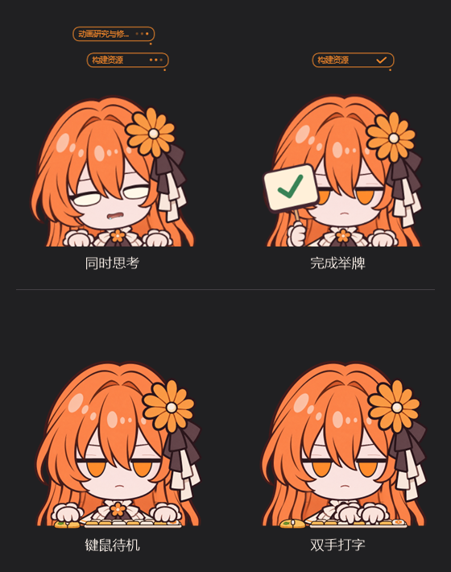

#  Claude in Codex

一个陪在 Windows Codex 窗口右下角的橙色桌宠。


- 眼神跟随鼠标，头发轻轻摆动。
- 锁定时悬停桌宠显示张开手套，按住头部切换到虚抓手套；解锁时仍用四向拖动箭头。
- 锁定位置时，按住头部不动会轻压，左右揉或画圈会跟着鼠标摇头，发梢稍后跟上。单击立即打开用量面板；面板开着时再点桌宠，每点一次就压扁回弹一次。
- 点击查看 Codex 用量，解锁后可拖动并记住位置。
- 跟随 Codex 窗口移动、最小化和隐藏，自动匹配明暗主题。
- 每个进行中的对话都有独立的思考气泡。完成时，对应气泡打勾后淡出，桌宠保持待机表情，用鼠标手举起绿色勾牌，再收回。
- 压缩上下文时，气泡里的省略号会换成叠纸图标；有子任务时显示运行数量，悬停可看本轮耗时。子任务结束只更新计数，不举牌。
- 键鼠联动默认开启：打字时双手按键盘分区落指，按住不放会保持触键。点鼠标左键压食指，右键压小指，滚动时中指轻点。

## 动作预览



## 部件拆分


## 蒙皮示意


## 安装

角色制作和运行时配置见[桌宠角色制作流程](docs/character-pipeline.md)。

需要 Windows 10/11 x64；从源码构建需要 .NET 10 SDK。

```powershell
git clone https://github.com/myosotis0v0/claude-in-codex.git
cd claude-in-codex
.\scripts\package.ps1
codex plugin marketplace add "$PWD\dist\claude-in-codex"
codex plugin add claude-in-codex@claude-in-codex-local
```

重启 Codex 后开始聊天，或发送“启动 Claude in Codex”，即可打开桌宠。
