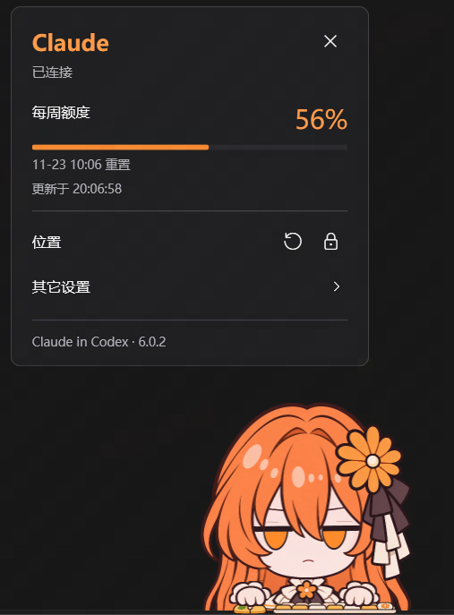
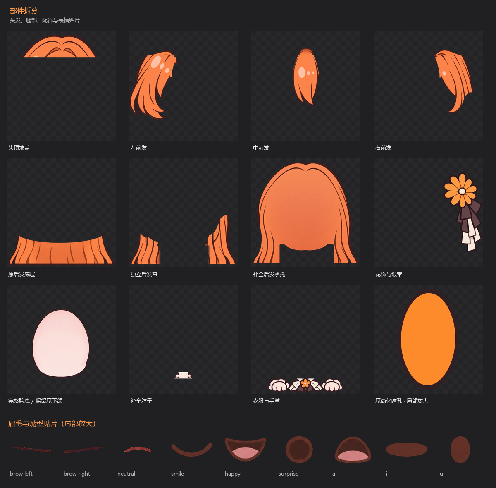
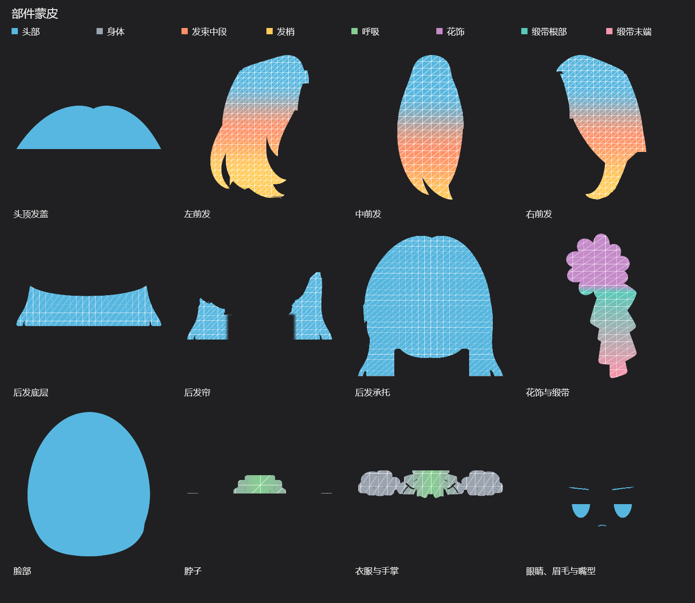

#  Claude in Codex

一个陪在 Windows Codex 窗口右下角的橙色桌宠。



- 眼神跟随鼠标，头发轻轻摆动。
- 点击查看 Codex 用量，解锁后可拖动并记住位置。
- 跟随 Codex 窗口移动、最小化和隐藏，自动匹配明暗主题。
- 任务开始和结束时播放短暂的思考、完成提示。

## 动作预览


## 部件拆分



## 蒙皮示意



## 安装

需要 Windows 10/11 x64；从源码构建需要 .NET 10 SDK。

```powershell
git clone https://github.com/myosotis0v0/claude-in-codex.git
cd claude-in-codex
.\scripts\package.ps1
codex plugin marketplace add "$PWD\dist\claude-in-codex"
codex plugin add claude-in-codex@claude-in-codex-local
```

重启 Codex 后开始聊天，或发送“启动 Claude in Codex”，即可打开桌宠。
