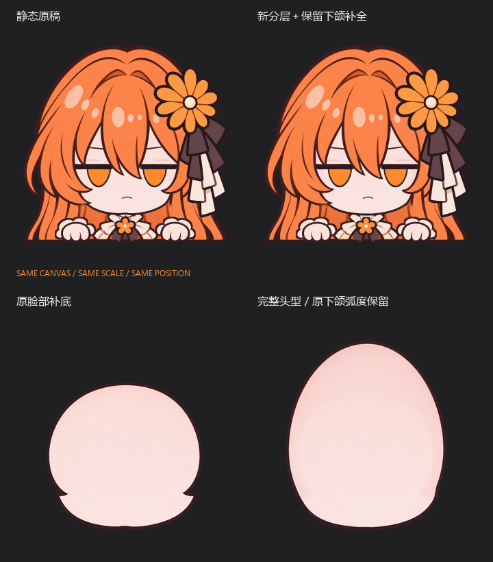
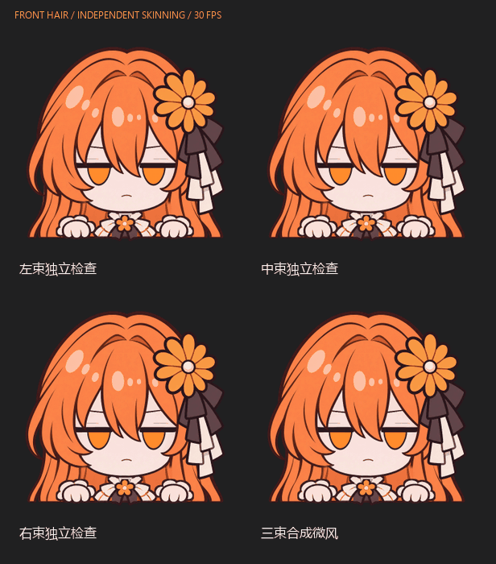

# Front Hair V2

原稿配准的左／中／右三束、独立蒙皮和物理响应，以及完整脸部补底。0.5.0 将这批素材接入插件；构建、离屏检查与实际安装状态分开记录。最终离屏检查结果见 `production-readiness.json`；适用范围为下述受约束参数，不保证任意扩大变形后的结果。未控制用户桌面，真实交互由用户重启验证。

## 造型保真

- 可见头发纹理／描边从原稿提取，生成稿仅提供隐藏根部、内侧重叠区及承托内容，没有把重新生成的整束替换到原稿可见区域。
- 脸是独立、闭合、内部不透明的完整头型，不按头发遮挡裁切。采用 `face-jaw-preserved.png`；收尖下巴的 `face-egg-complete.png` 是弃用试稿。
- 生产 `face.png` 上方补齐额头／脸侧，880..950 平滑接回原下颌。y>=950 除中央浅凹修复框 `(550,1020)..(701,1080)` 外仍逐像素保留；框内局部垂直配准原描边，消除凹入，不收尖、不改变下颌宽度。`chin-neck-report.json` 记录轮廓与保护检查。
- 眼睛、眉毛、嘴型、花饰和手掌沿用原素材，尺寸与坐标不变。脖子仅补平少量露出的皮肤，去掉误混入的衣领中缝；外侧花边及花饰不变。没有新增眼白／下眼睑，没有镜像角色。
- `registration-report.json` 的零差异只指“相同最终脸底上的原头发 vs 分件拼回头发”，不表示脸型修正前后整张图完全相同。



两边使用同一画布、缩放与位置。分件图仅单独适配裁剪边界展示，不用于证明整体比例。实际采样后的微小差异单列在 `deformation-report.json` 的 `NeutralSampling`。

## 蒙皮与动态

- 坐标画布 1254x1254；沿用 SkiaSharp 4.156.1，不加入新绘制依赖。共享代码在 `plugins/claude-in-codex/src/MotionCore`。
- 三束各有独立中段／发梢骨骼与阻尼链，根部在 y<=365 固定跟随头部；两侧下端在 990..1160 渐变回身体根，避免带动手掌／底部。
- 左、中、右二级响应分别为 `(36,9)/(22,7)`、`(53,12)/(34,9)`、`(43,10)/(27,8)`，固定 120 Hz。不是整图摆动，也不是同一响应的固定比例副本。
- 左／中／右输入角分别限制为 ±2.5／±1.4／±2.2 度，发梢关节在层级中再乘 0.5。切换表情不重置物理状态。
- 保持 2x 物理分辨率、高质量纹理采样、预乘 Alpha 缩回；气泡仍为最后绘制的独立 WPF 前景层。
- 根部保留隐藏保护边并由固定头顶层覆盖，不应绕开根部锁定将隐藏连接区任意拉伸。



单束检查片用 1.5 倍风输入便于观察；合成 `wind.gif` 使用真实默认幅度。每组源动画 180 帧／30 FPS／6 秒，GIF 合并完全相同的量化帧时仍保持 6000 ms。无损 WebP 保留透明通道。

## 验证与交付

- 下颌／脖子修复框外逐像素保护，中央下巴无内凹、颈部无中缝，并复查保存后的 PNG；原头发与分件拼接的本征像素对照。
- 200／280／336／512 像素同尺度静态对照；同脸底的头发采样误差独立检查，脸侧修正不混入头发保真结论。
- 完整脸部行扫描、连续轮廓／内部不透明检查；发束连通性与无游离异物检查。
- 8 组、1440 帧：独立驱动／微风／待机／思考／摇头／摸头；每帧检查 10,000 余个发根内部点、脸部／手掌采样点、网格翻转和画布边缘。
- 192 组角度极限及 ±4 度头部倾斜检查；这些结果不代表任意未知姿态的保证。
- 实际 WPF 候选使用相同 PNG，运行 motion、quality 和 UI 回归诊断，不展示或操控窗口。真实宿主交互仍由用户验证。
- 人工离屏复核：明暗静态对照、四相位接缝放大图、分件、关键帧与极限帧。已处理描边误归属、脸侧接头、底色泄漏和根部采样缝。

数据与代码包为 `previews/front-hair-v2/front-hair-production-v2.zip`，不含大图集、生成草稿或原生库；`rig-v2.json` 导出坐标、权重和索引。`layers/hair.png` 是旧参考图，分层渲染器不会加载它。`generated/`、`extracted/` 和早期 `source-validation.json` 保留制作历史，不是最终生产门槛。

初始补全使用内置 image generator，提示词见 `PROMPTS.md`；本次下巴／脖子小修使用现有 Skia 素材构建流程，修复范围及原图保护均可重现。离屏检查不能替代真实桌面交互测试，安装内容与当前运行版本分开核实。

## 复现

```powershell
dotnet run --project tools/MotionLab/MotionLab.csproj -c Release -- D:/ToyProjects/claude-in-codex front-hair-build
dotnet run --project tools/MotionLab/MotionLab.csproj -c Release -- D:/ToyProjects/claude-in-codex front-hair-preview
python tools/export_front_hair_v2.py
```

WPF 候选用 `-p:MotionAssetRoot=D:/ToyProjects/claude-in-codex/assets/claude-motion-v2/layers` 发布到独立目录，不改变默认资产或安装。最终命令 `front-hair-audit` 还要求候选三项离屏报告及全部媒体为当前版本。
