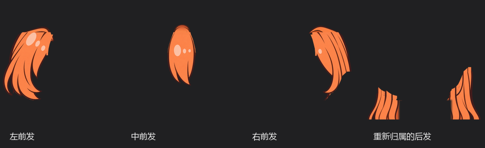
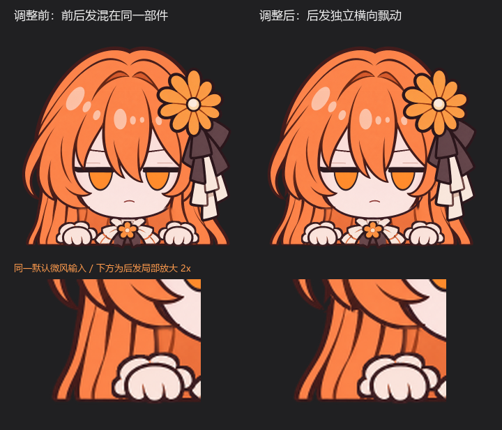

# Front / Rear Ownership Correction

0.5.2 把左右前发中误包含的下垂后发块移动到独立 `hair-curtain.png`，不是用混合权重掩盖分层错误。前发仍使用原有三束骨骼与物理参数；后发、承托层和新拆回的发帘不再受前发骨骼控制。

- 新边界沿发束下缘及被配饰遮住的连接区分开，保留脸旁前景发梢；从既有补全素材延伸 48 源像素隐藏重叠，未重画原稿可见纹理。
- 静态原尺寸拼回 RGBA 零差异；脸、下巴、脖子、眼睛、花饰、手掌、中前发及其他未拆分素材字节不变。检查见 `split-report.json`。
- 后发风场为整行相同的纯横向位移，`t=clamp((y-365)/(1218-365),0,1)`，位移按 `t*t` 增大。不再中部鼓动、下端回到固定根骨。
- 复用现有持续风力弹簧，横移为 `clamp(-10*(0.7*sway+0.3*tip),-14,14)` 源像素；此限制保留原有绘制窗口边缘余量。头部跟随独立于风偏移，下端不产生风致竖向移动。
- `Renderer` 通过 `hair-curtain.png` 选择此策略；旧 V2 素材继续走旧实现，供同输入前后对比。新增一个轻量网格，没有新运行库或动画图集。
- 预览采用真实默认微风幅度、同一前发姿态与同一时间采样，不放大风力。180 帧、30 FPS、6 秒；36 组风／头部／前发组合检查无翻面，前发顶点运动与旧版完全相同。
- 专项检查包括拆分归属、静态拼接、逐行单调横移、上端固定、下端不归零、抽样遮挡与手掌保护。离屏结果不能替代真实桌面验证，也不保证任意放大参数后的形变。





```powershell
dotnet run --project tools/MotionLab/MotionLab.csproj -c Release -- D:/ToyProjects/claude-in-codex rear-hair-split
dotnet run --project tools/MotionLab/MotionLab.csproj -c Release -- D:/ToyProjects/claude-in-codex rear-hair-preview
python tools/export_rear_hair_flow.py
```
