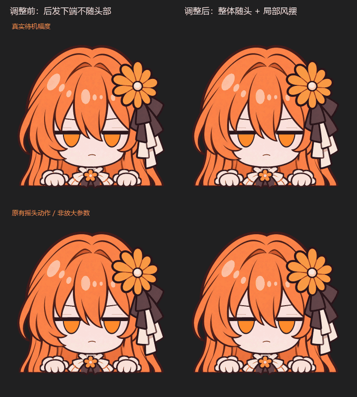
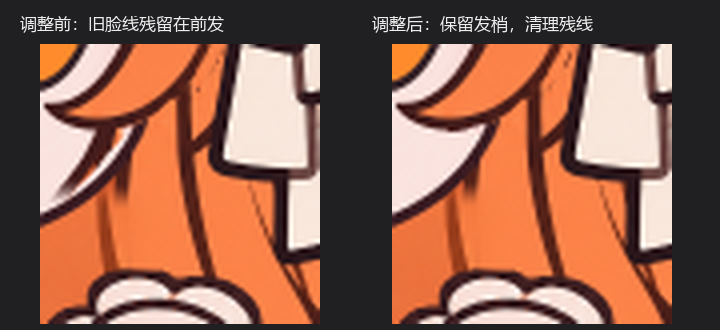

# Head-Attached Rear Hair

Version 0.5.3 corrects the 0.5.2 rear attachment without changing the head pivot, foreground dynamics or source art style.

- All three rear layers (`rear-hair`, `hair-backing`, `hair-curtain`) belong completely to the head. There is no body-root blend at the lower tips.
- Wind is applied before the parent transform: `Transform(point + (RearOffset * Amount(y), 0), headSkin)`. The whole hair inherits the same head translation and rotation; local bending stays horizontal, root-fixed and stronger toward the tips.
- Existing spring parameters, amplitudes, animation timing and front-hair bones are unchanged. No new library, bone chain or texture is needed for attachment.
- Material is copied from V3, except for a small source-coordinate mask correction on the right front curl. The old cheek contour had incorrectly remained attached below the upper curl. Only that local spur is removed; the actual curled tip is retained. The original viewer-right silhouette is asymmetric, not evidence of a missing extra strand.
- The right-front cleanup changes 1,839 pixels inside `x=834..960, y=930..1029`; all other pixels and the other 21 PNG assets are unchanged. Face, original flat-round jaw, neck, eyes, flower and paws are protected. See `cleanup-report.json`.
- `artifacts/rear-hair-attachment/report.json` checks full parent inheritance, head-local wind, non-inverted rear meshes across 14 states / 60 time samples per state, and 360 rendered idle/shake frames. The baseline was captured with the original 0.5.2 code before changing it. Actual authored amplitudes, 30 FPS, 2x rendering, no exaggerated preview motion.
- Baseline capture is deliberately rejected by the fixed runtime: it must be run on the original 0.5.2 implementation. Existing baseline frames remain under `artifacts/rear-hair-attachment/frames/before`.
- Offscreen checks are not proof of native desktop interaction. Installation activation and the final visual check require a manual restart; mouse, keyboard and user settings are not modified.





```powershell
dotnet run --project tools/MotionLab/MotionLab.csproj -c Release -- D:/ToyProjects/claude-in-codex right-cheek-cleanup
dotnet run --project tools/MotionLab/MotionLab.csproj -c Release -- D:/ToyProjects/claude-in-codex rear-hair-attachment-preview
python tools/export_rear_hair_attachment.py
```
